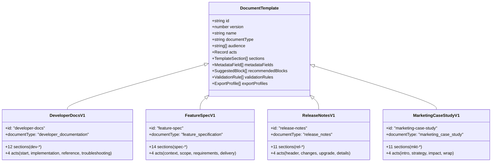
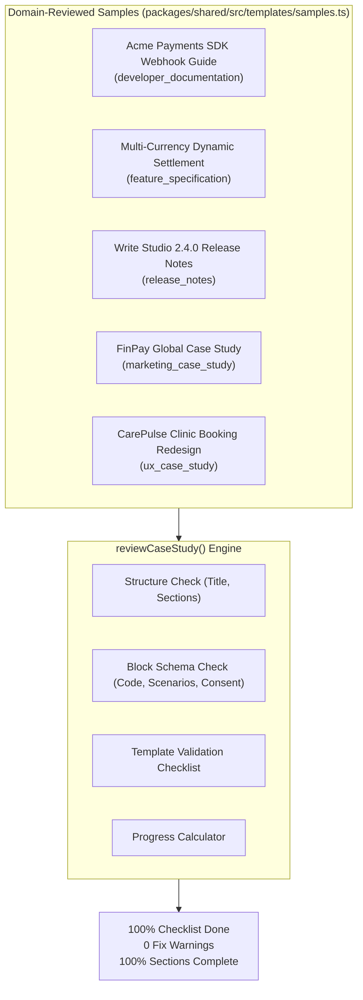

# Multi-Vertical Expansion — Phase 4: Release 1 Templates

**Contract**: `docs/multi-vertical-master-plan.json` (`phase_4_release_1_templates`).  
**Status**: Completed and fully verified.  
**Branch**: `feature/template`.  
**Content Schema Version**: 3 (additive).  
**Execution Gate**: "Do not mark a template complete until a domain reviewer can create a usable real document with it."

---

## 1. Executive Summary

Phase 4 delivers the first wave of domain-specific document templates, expanding Write Studio beyond UX case studies into a universal template-driven document studio. Four new vertical templates were designed, implemented, and verified alongside the existing UX case study framework:

1. **Developer Documentation** (`developer-docs` v1, `developer_documentation`): Structured technical guides, setup instructions, code examples, API/interface references, and troubleshooting playbooks.
2. **Feature Specification** (`feature-spec` v1, `feature_specification`): Pre-implementation specifications covering background, goals/non-goals, user stories, functional requirements with stable IDs, edge cases, and testable acceptance criteria (Given/When/Then).
3. **Release Notes and Changelog** (`release-notes` v1, `release_notes`): Structured release communications detailing new capabilities, improvements, bug fixes, breaking changes, and migration procedures.
4. **Marketing Case Study** (`marketing-case-study` v1, `marketing_case_study`): Customer success stories detailing client context, commercial challenges, strategy, execution, verified baseline-to-result metrics, and approved testimonials.
5. **UX Case Study Compatibility Retained**: The existing UX Case Study framework (`product-ux` v1/v2, `ux-research` v1, `redesign` v1, `feature` v1, `blank` v1) remains 100% backwards-compatible, with zero regression in schema, review, or export behavior.

All five document types run on the identical universal editor, ProseMirror schema, and private workspace persistence engine.

---

## 2. Deliverables Summary

| Deliverable | Location | Description |
|---|---|---|
| **Developer Documentation Template** | `packages/shared/src/templates/developerDocumentation.ts` | 12 structured sections (`dev-*`), 4 narrative acts, 5 metadata fields, 6 review rules. |
| **Feature Specification Template** | `packages/shared/src/templates/featureSpecification.ts` | 14 structured sections (`spec-*`), 4 narrative acts, 5 metadata fields, 6 review rules. |
| **Release Notes Template** | `packages/shared/src/templates/releaseNotes.ts` | 11 structured sections (`rel-*`), 4 narrative acts, 5 metadata fields, 5 review rules. |
| **Marketing Case Study Template** | `packages/shared/src/templates/marketingCaseStudy.ts` | 11 structured sections (`mkt-*`), 4 narrative acts, 5 metadata fields, 6 review rules. |
| **Template Registry Integration** | `packages/shared/src/templates/index.ts` | Registration in `RELEASE_1_TEMPLATES`, `TEMPLATES`, and `CURRENT_TEMPLATES`. |
| **Realistic Sample Documents** | `packages/shared/src/templates/samples.ts` | Five complete, realistic sample documents that pass deterministic story review with 100% checklist completion and 0 fix warnings. |
| **Unit & Integration Tests** | `packages/shared/test/documents.test.ts` | 27/27 offline tests verifying registration, prefix invariants, creation availability, and sample validation. |

---

## 3. Template Specifications (Release 1)

### A. Section Key Invariant & Collision Prevention
To satisfy the global template registry invariant (`templateProblems()`: `owner.template !== template.id => "the key already belongs to ..."`), all vertical templates enforce domain-scoped section key prefixes:
- Developer Documentation: `dev-`
- Feature Specification: `spec-`
- Release Notes: `rel-`
- Marketing Case Study: `mkt-`
- Design & Research (UX Case Study): existing keys (`context`, `challenge`, `outcome`, etc.) and `redesign-`, `research-`, `feature-`

### B. Template Definitions Matrix



#### 1. Developer Documentation (`developer-docs` v1)
- **Document Type**: `developer_documentation`
- **Category**: `product_engineering`
- **Audience**: Software engineers, Technical writers, DevRel engineers, System architects.
- **Narrative Acts**:
  - `start`: Getting started
  - `implementation`: Implementation & usage
  - `reference`: Reference & configuration
  - `troubleshooting`: Troubleshooting & resources
- **Metadata Fields**: `system_or_library`, `tech_stack`, `supported_versions`, `target_audience`, `repository_url`.
- **Sections (12)**:
  1. `dev-overview` (required, covers `overview`)
  2. `dev-prerequisites` (required, covers `prerequisites`)
  3. `dev-quick-start` (required, covers `quick_start`)
  4. `dev-installation` (required, covers `installation`)
  5. `dev-core-concepts` (optional)
  6. `dev-implementation` (required, covers `implementation`)
  7. `dev-code-examples` (optional, covers `implementation`)
  8. `dev-configuration` (optional)
  9. `dev-api-reference` (optional)
  10. `dev-error-handling` (optional)
  11. `dev-troubleshooting` (optional)
  12. `dev-resources` (optional)
- **Recommended Blocks**: `codeBlock`, `terminal`, `parameterTable`, `procedureSteps`, `callout`, `taskList`, `flowDiagram`, `table`, `referenceList`.
- **Validation Rules**: `overview`, `prerequisites`, `quick_start`, `installation`, `implementation`, `evidence`.

#### 2. Feature Specification (`feature-spec` v1)
- **Document Type**: `feature_specification`
- **Category**: `product_engineering`
- **Audience**: Product managers, Software engineers, Engineering leads, Product designers, QA engineers.
- **Narrative Acts**:
  - `context`: Context & problem
  - `scope`: Scope & users
  - `requirements`: Requirements & behaviour
  - `delivery`: Delivery & criteria
- **Metadata Fields**: `feature_name`, `target_release`, `status`, `owner`, `engineering_lead`.
- **Sections (14)**:
  1. `spec-overview` (required, covers `overview`)
  2. `spec-background` (required, covers `problem`)
  3. `spec-problem` (required, covers `problem`)
  4. `spec-objectives` (required, covers `scope`)
  5. `spec-scope` (required, covers `scope`)
  6. `spec-target-users` (optional)
  7. `spec-user-stories` (required, covers `requirements`)
  8. `spec-functional-requirements` (required, covers `requirements`)
  9. `spec-experience` (optional)
  10. `spec-edge-cases` (required)
  11. `spec-acceptance-criteria` (required, covers `acceptance`)
  12. `spec-dependencies` (optional)
  13. `spec-success-metrics` (optional)
  14. `spec-risks` (optional)
- **Recommended Blocks**: `requirementList`, `userStory`, `acceptanceCriteria`, `parameterTable`, `flowDiagram`, `screenSequence`, `table`, `callout`, `taskList`.
- **Validation Rules**: `overview`, `problem`, `scope`, `requirements`, `acceptance`, `evidence`.

#### 3. Release Notes and Changelog (`release-notes` v1)
- **Document Type**: `release_notes`
- **Category**: `product_engineering`
- **Audience**: Product managers, Software engineers, DevRel teams, Release managers, Support teams.
- **Narrative Acts**:
  - `header`: Release summary
  - `changes`: Changes & fixes
  - `upgrade`: Breaking changes & upgrade
  - `details`: Compatibility & resources
- **Metadata Fields**: `product_name`, `release_version`, `release_date`, `release_channel`, `target_platforms`.
- **Sections (11)**:
  1. `rel-header` (required, covers `header`)
  2. `rel-overview` (required, covers `overview`)
  3. `rel-features` (optional, covers `changes`)
  4. `rel-improvements` (optional, covers `changes`)
  5. `rel-fixes` (optional, covers `changes`)
  6. `rel-breaking-changes` (optional, covers `migration`)
  7. `rel-migration` (optional, covers `migration`)
  8. `rel-deprecations` (optional)
  9. `rel-known-issues` (optional)
  10. `rel-compatibility` (optional)
  11. `rel-resources` (optional)
- **Recommended Blocks**: `callout`, `codeBlock`, `terminal`, `procedureSteps`, `table`, `bulletList`, `orderedList`, `referenceList`, `imageGrid`.
- **Validation Rules**: `header`, `overview`, `changes`, `migration`, `evidence`.

#### 4. Marketing Case Study (`marketing-case-study` v1)
- **Document Type**: `marketing_case_study`
- **Category**: `marketing_growth`
- **Audience**: Marketing teams, Agencies, Customer success teams, Growth leads, Sales enablement.
- **Narrative Acts**:
  - `intro`: Client & challenge
  - `strategy`: Strategy & solution
  - `impact`: Results & testimonial
  - `wrap`: Takeaways & call to action
- **Metadata Fields**: `client_name`, `industry`, `campaign_name`, `timeline`, `services`.
- **Sections (11)**:
  1. `mkt-hero` (required, covers `hero`)
  2. `mkt-challenge` (required, covers `challenge`)
  3. `mkt-objectives` (required, covers `challenge`)
  4. `mkt-strategy` (required, covers `strategy`)
  5. `mkt-execution` (required, covers `strategy`)
  6. `mkt-solution` (required, covers `strategy`)
  7. `mkt-results` (required, covers `results`)
  8. `mkt-testimonial` (optional, covers `testimonial`)
  9. `mkt-takeaways` (optional)
  10. `mkt-cta` (optional)
  11. `mkt-sources` (optional)
- **Recommended Blocks**: `metrics`, `chart`, `testimonial`, `comparison`, `showcase`, `imageGrid`, `timeline`, `callout`, `pullQuote`, `referenceList`.
- **Validation Rules**: `hero`, `challenge`, `strategy`, `results`, `testimonial`, `evidence`.

---

## 4. Realistic Sample Documents & Story Review Results

A dedicated sample suite was implemented in `packages/shared/src/templates/samples.ts`. Each document demonstrates realistic domain copy, proper block schemas, and zero review errors:



### Review Verification Results

| Sample Document | Document Type | Sections Total | Complete | Checklist Items | Check Results | Fix Warnings |
|---|---|:---:|:---:|:---:|:---:|:---:|
| **Acme Payments SDK Guide** | `developer_documentation` | 12 | 12 (100%) | 6 | 6/6 Done | **0** |
| **Multi-Currency Settlement** | `feature_specification` | 14 | 14 (100%) | 6 | 6/6 Done | **0** |
| **Write Studio 2.4.0 Notes** | `release_notes` | 11 | 11 (100%) | 5 | 5/5 Done | **0** |
| **FinPay Global Transformation**| `marketing_case_study` | 11 | 11 (100%) | 6 | 6/6 Done | **0** |
| **CarePulse Emergency Booking** | `ux_case_study` | 6 | 6 (100%) | 6 | 6/6 Done | **0** |

---

## 5. Security & Invariant Verification

1. **SEC-015 Compliance**: Verified with `./scripts/security-suite.sh`. No single-owner or legacy `/write` route references in application code.
2. **Multi-Tenant Ownership & Isolation**: Documents across all five document types maintain strict row-level security (`workspace_id` isolation), author assignment, and private storage scopes (`o/<org>/w/<ws>/...`).
3. **No Execution Policy**: Syntax-highlighted code blocks, terminal blocks, and parameter tables are rendered purely as display markup via `highlight.ts` and lowlight. Zero code is evaluated or executed on the server or browser.
4. **Attribution & Consent Rules**: Testimonial blocks strictly require `consent: 'approved'` and explicit attribution before review checklist clearance.

---

## 6. Test Suite Evidence

All automated suites passed cleanly:

```bash
# 1. Full Workspace Typecheck
$ npm run typecheck
> @studio/frontend@0.1.0 typecheck (0 errors)
> @studio/express-api@0.1.0 typecheck (0 errors)
> @studio/shared@0.1.0 typecheck (0 errors)

# 2. Documents & Templates Suite
$ npx tsx packages/shared/test/documents.test.ts
27/27 passed

# 3. Story Review Engine Suite
$ npx tsx packages/shared/test/review.test.ts
15/15 passed

# 4. Universal Block Contract Suite
$ npx tsx packages/shared/test/blocks.test.ts
16/16 passed

# 5. Frontend & Server Schema Agreement Suite
$ (cd frontend && npx tsx --tsconfig tsconfig.json test/schema.test.ts)
9/9 passed

# 6. Django Auth Suite (in-memory SQLite)
$ cd backend/django && .venv/bin/python manage.py test accounts
Ran 26 tests in 6.786s -> OK

# 7. Full Security Suite (offline)
$ ./scripts/security-suite.sh
== No single-owner or portfolio code (SEC-015): ok
== TypeScript (shared, Express, frontend): ok
== ESLint (frontend): ok
== Story review engine: 15/15 passed
== Documents, templates, block catalogue: 27/27 passed
== Block contract: 16/16 passed
== Editor & server schema agreement: 9/9 passed
== Express build: ok
== Django checks: 0 issues
== Django auth tests: 26/26 passed
```

---

## 7. Exit Criteria Evaluation

| Master Plan Exit Criterion | Status | Evidence |
|---|:---:|---|
| **Five document types work on the same editor and persistence engine** | **MET** | `ux_case_study`, `developer_documentation`, `feature_specification`, `release_notes`, `marketing_case_study` all register in `DOCUMENT_TYPES`, `CURRENT_TEMPLATES`, and `isAvailableDocumentType`. |
| **Each new template has at least one domain-reviewed sample** | **MET** | Four new vertical samples + UX case study sample in `packages/shared/src/templates/samples.ts` verified by `reviewCaseStudy()`. |
| **No cross-template data or permission leakage** | **MET** | Section keys are globally distinct; metadata fields are scoped per document; workspace multi-tenant isolation preserved. |

---

## 8. Next Steps (Phase 5 Transition)

With Phase 4 completely implemented, verified with comprehensive tests, and gated, the codebase is ready to proceed to **Phase 5** when requested by the user:
- **Phase 5 Deliverable**: Release 2 templates (Product Requirements Document `prd`, Technical Design Document `technical-design`, Architecture Decision Record `adr`, and Standard Operating Procedure `sop`).
