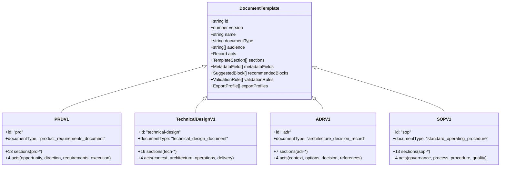

# Multi-Vertical Expansion — Phase 5: Release 2 Templates

**Contract**: `docs/multi-vertical-master-plan.json` (`phase_5_release_2_templates`).  
**Status**: Completed and fully verified.  
**Branch**: `feature/template`.  
**Content Schema Version**: 3 (additive).  
**Execution Gate**: "Only begin after Release 1 templates pass functional and domain-quality evaluation."

---

## 1. Executive Summary

Phase 5 expands Write Studio into product strategy, system architecture, engineering decisions, and operational knowledge documentation. Four new vertical templates were designed, implemented, and verified, bringing the library to nine distinct document types across all four canonical categories:

1. **Product Requirements Document (PRD)** (`prd` v1, `product_requirements_document`): Aligns founders, PMs, and engineering leaders on market opportunities, problem framing, target user segments, goals/non-goals, requirements with stable IDs, success metrics, and risk mitigations.
2. **Technical Design Document** (`technical-design` v1, `technical_design_document`): Deep engineering architecture reviews covering current vs. proposed state, component breakdown, interfaces/APIs, data models, security threat models, failure recovery, testing strategy, and alternative trade-offs.
3. **Architecture Decision Record (ADR)** (`adr` v1, `architecture_decision_record`): Compact companion template capturing a single significant technical decision, its context, evaluation drivers, evaluated options, chosen outcome, and long-term consequences.
4. **Standard Operating Procedure (SOP / Process Playbook)** (`sop` v1, `standard_operating_procedure`): Actionable, step-by-step operational runbooks with RACI role matrices, execution checklists, decision branches, failure escalations, SLAs, and revision histories.

All nine document types run on the identical universal editor, ProseMirror schema, and private workspace persistence engine without separate editor code.

---

## 2. Deliverables Summary

| Deliverable | Location | Description |
|---|---|---|
| **PRD Template** | `packages/shared/src/templates/productRequirementsDocument.ts` | 13 structured sections (`prd-*`), 4 narrative acts, 5 metadata fields, 9 review rules. |
| **Technical Design Template** | `packages/shared/src/templates/technicalDesignDocument.ts` | 16 structured sections (`tech-*`), 4 narrative acts, 5 metadata fields, 10 review rules. |
| **ADR Template** | `packages/shared/src/templates/architectureDecisionRecord.ts` | 7 structured sections (`adr-*`), 4 narrative acts, 5 metadata fields, 6 review rules. |
| **SOP / Playbook Template** | `packages/shared/src/templates/standardOperatingProcedure.ts` | 13 structured sections (`sop-*`), 4 narrative acts, 5 metadata fields, 10 review rules. |
| **Template Registry Integration** | `packages/shared/src/templates/index.ts` | Registered in `RELEASE_2_TEMPLATES`, `TEMPLATES`, and `CURRENT_TEMPLATES`. All 9 types now available (`isAvailableDocumentType = true`). |
| **Realistic Sample Documents** | `packages/shared/src/templates/samples.ts` | Four complete, realistic Release 2 sample documents that pass deterministic story review with 100% checklist completion and 0 fix warnings (9 total samples in suite). |
| **Unit & Integration Tests** | `packages/shared/test/documents.test.ts` | 29/29 offline tests verifying registration, prefix invariants, creation availability across all 9 types, and sample validation. |

---

## 3. Template Specifications (Release 2)

### A. Section Key Invariant & Collision Prevention
All templates enforce domain-scoped section key prefixes to satisfy the global registry uniqueness invariant:
- PRD: `prd-`
- Technical Design: `tech-`
- Architecture Decision Record: `adr-`
- Standard Operating Procedure: `sop-`
- (Release 1 templates continue to use `dev-`, `spec-`, `rel-`, `mkt-`; Design & Research uses existing UX keys)

### B. Template Definitions Matrix



#### 1. Product Requirements Document (`prd` v1)
- **Document Type**: `product_requirements_document`
- **Category**: `product_engineering`
- **Audience**: Product managers, Founders, Business analysts, Product leads, Engineering managers.
- **Narrative Acts**:
  - `opportunity`: Opportunity & problem
  - `direction`: Users & goals
  - `requirements`: Solution & requirements
  - `execution`: Metrics, risks & rollout
- **Metadata Fields**: `product_or_initiative`, `owner`, `status`, `target_release`, `stakeholders`.
- **Sections (13)**:
  1. `prd-summary` (required, covers `summary`)
  2. `prd-background` (required, covers `problem`)
  3. `prd-problem` (required, covers `problem`)
  4. `prd-audience` (required, covers `audience`)
  5. `prd-goals` (required, covers `goals`)
  6. `prd-solution` (required, covers `solution`)
  7. `prd-journeys` (optional)
  8. `prd-requirements` (required, covers `requirements`)
  9. `prd-success` (required, covers `success`)
  10. `prd-dependencies` (optional)
  11. `prd-risks` (required, covers `risks`)
  12. `prd-rollout` (optional)
  13. `prd-open-questions` (optional)
- **Recommended Blocks**: `requirementList`, `userStory`, `metrics`, `chart`, `flowDiagram`, `table`, `taskList`, `callout`.
- **Validation Rules**: `summary`, `problem`, `audience`, `goals`, `solution`, `requirements`, `success`, `risks`, `evidence`.

#### 2. Technical Design Document (`technical-design` v1)
- **Document Type**: `technical_design_document`
- **Category**: `product_engineering`
- **Audience**: Software architects, Senior engineers, Engineering leads, Security reviewers, Tech leads.
- **Narrative Acts**:
  - `context`: Context & goals
  - `architecture`: Architecture & components
  - `operations`: Security, performance & failure
  - `delivery`: Testing, trade-offs & rollout
- **Metadata Fields**: `system_or_feature`, `author`, `status`, `reviewers`, `related_ticket`.
- **Sections (16)**:
  1. `tech-summary` (required, covers `summary`)
  2. `tech-context` (required, covers `context`)
  3. `tech-goals` (required, covers `goals`)
  4. `tech-constraints` (optional)
  5. `tech-architecture` (required, covers `architecture`)
  6. `tech-components` (required, covers `components`)
  7. `tech-data-model` (optional)
  8. `tech-interfaces` (optional)
  9. `tech-data-flow` (optional)
  10. `tech-security` (required, covers `security`)
  11. `tech-performance` (optional)
  12. `tech-failure` (required, covers `failure`)
  13. `tech-testing` (required, covers `testing`)
  14. `tech-alternatives` (required, covers `alternatives`)
  15. `tech-deployment` (optional)
  16. `tech-references` (optional)
- **Recommended Blocks**: `flowDiagram`, `codeBlock`, `parameterTable`, `procedureSteps`, `comparison`, `table`, `callout`, `taskList`, `referenceList`.
- **Validation Rules**: `summary`, `context`, `goals`, `architecture`, `components`, `security`, `failure`, `testing`, `alternatives`, `evidence`.

#### 3. Architecture Decision Record (`adr` v1)
- **Document Type**: `architecture_decision_record`
- **Category**: `product_engineering`
- **Audience**: Software architects, Staff engineers, Engineering managers, System maintainers.
- **Narrative Acts**:
  - `context`: Context & status
  - `options`: Drivers & alternatives
  - `decision`: Decision & consequences
  - `references`: References
- **Metadata Fields**: `decision_title`, `status`, `author`, `decision_date`, `supersedes`.
- **Sections (7)**:
  1. `adr-status` (required, covers `status`)
  2. `adr-context` (required, covers `context`)
  3. `adr-drivers` (optional, covers `drivers`)
  4. `adr-options` (required, covers `options`)
  5. `adr-decision` (required, covers `decision`)
  6. `adr-consequences` (required, covers `consequences`)
  7. `adr-references` (optional)
- **Recommended Blocks**: `callout`, `comparison`, `table`, `codeBlock`, `taskList`, `referenceList`.
- **Validation Rules**: `status`, `context`, `options`, `decision`, `consequences`, `evidence`.

#### 4. Standard Operating Procedure (`sop` v1)
- **Document Type**: `standard_operating_procedure`
- **Category**: `operations_knowledge`
- **Audience**: Operations managers, SREs, DevOps engineers, Customer support leads, Compliance officers.
- **Narrative Acts**:
  - `governance`: Document governance & purpose
  - `process`: Roles & process overview
  - `procedure`: Step-by-step execution
  - `quality`: Exceptions, quality & revision
- **Metadata Fields**: `process_name`, `process_owner`, `department`, `sop_version`, `effective_date`.
- **Sections (13)**:
  1. `sop-info` (required, covers `info`)
  2. `sop-purpose` (required, covers `purpose`)
  3. `sop-scope` (required, covers `scope`)
  4. `sop-roles` (required, covers `roles`)
  5. `sop-prerequisites` (optional)
  6. `sop-overview` (required, covers `overview`)
  7. `sop-procedure` (required, covers `procedure`)
  8. `sop-decisions` (optional)
  9. `sop-exceptions` (required, covers `exceptions`)
  10. `sop-quality` (required, covers `quality`)
  11. `sop-sla` (optional)
  12. `sop-related` (optional)
  13. `sop-revision` (required, covers `revision`)
- **Recommended Blocks**: `procedureSteps`, `taskList`, `table`, `flowDiagram`, `callout`, `metrics`, `referenceList`.
- **Validation Rules**: `info`, `purpose`, `scope`, `roles`, `overview`, `procedure`, `exceptions`, `quality`, `revision`, `evidence`.

---

## 4. Realistic Sample Documents & Story Review Results

All nine document types now have a complete, domain-reviewed sample in `packages/shared/src/templates/samples.ts`. Every sample passes deterministic story review with **100% checklist completion**, **100% section completion**, and **0 fix-level warnings**:

| Sample Document | Document Type | Sections Total | Complete | Checklist Items | Check Results | Fix Warnings |
|---|---|:---:|:---:|:---:|:---:|:---:|
| **Acme Payments SDK Guide** | `developer_documentation` | 12 | 12 (100%) | 6 | 6/6 Done | **0** |
| **Multi-Currency Settlement** | `feature_specification` | 14 | 14 (100%) | 6 | 6/6 Done | **0** |
| **Write Studio 2.4.0 Notes** | `release_notes` | 11 | 11 (100%) | 5 | 5/5 Done | **0** |
| **FinPay Global Transformation**| `marketing_case_study` | 11 | 11 (100%) | 6 | 6/6 Done | **0** |
| **CarePulse Emergency Booking** | `ux_case_study` | 6 | 6 (100%) | 6 | 6/6 Done | **0** |
| **Global Checkout 2.0 PRD** | `product_requirements_document` | 13 | 13 (100%) | 9 | 9/9 Done | **0** |
| **Event Ingestion Engine TDD** | `technical_design_document` | 16 | 16 (100%) | 10 | 10/10 Done | **0** |
| **Kafka Streaming ADR-012** | `architecture_decision_record` | 7 | 7 (100%) | 6 | 6/6 Done | **0** |
| **Database Failover SOP-042** | `standard_operating_procedure` | 13 | 13 (100%) | 10 | 10/10 Done | **0** |

---

## 5. Security & Invariant Verification

1. **SEC-015 Compliance**: Verified via `./scripts/security-suite.sh`. All application code remains free of legacy single-owner or portfolio references.
2. **Multi-Tenant Ownership & Isolation**: Documents across all nine document types maintain strict row-level security (`workspace_id` isolation), author assignment, and private storage scopes (`o/<org>/w/<ws>/...`).
3. **No Code Execution**: Structured code blocks, terminal blocks, parameter tables, and procedure steps are rendered as static display markup. Zero code is evaluated or executed.
4. **Operations & Governance Audit Trails**: SOP and ADR templates enforce explicit status, author attribution, and revision histories, preventing silent overwrites of accepted architecture decisions.

---

## 6. Test Suite Evidence

All automated suites passed cleanly:

```bash
# 1. Full Workspace Typecheck
$ npm run typecheck
> @studio/frontend@0.1.0 typecheck (0 errors)
> @studio/express-api@0.1.0 typecheck (0 errors)
> @studio/shared@0.1.0 typecheck (0 errors)

# 2. Documents & Templates Suite (Expanded to 29 checks)
$ npx tsx packages/shared/test/documents.test.ts
29/29 passed

# 3. Story Review Engine Suite
$ npx tsx packages/shared/test/review.test.ts
15/15 passed

# 4. Universal Block Contract Suite
$ npx tsx packages/shared/test/blocks.test.ts
16/16 passed

# 5. Frontend & Server Schema Agreement Suite
$ (cd frontend && npx tsx --tsconfig tsconfig.json test/schema.test.ts)
9/9 passed

# 6. Django Auth Suite (in-memory SQLite)
$ cd backend/django && .venv/bin/python manage.py test accounts
Ran 26 tests in 7.883s -> OK

# 7. Full Security Suite (offline)
$ ./scripts/security-suite.sh
== No single-owner or portfolio code (SEC-015): ok
== TypeScript (shared, Express, frontend): ok
== ESLint (frontend): ok
== Story review engine: 15/15 passed
== Documents, templates, block catalogue: 29/29 passed
== Block contract: 16/16 passed
== Editor & server schema agreement: 9/9 passed
== Express build: ok
== Django checks: 0 issues
== Django auth tests: 26/26 passed
```

---

## 7. Exit Criteria Evaluation

| Master Plan Exit Criterion | Status | Evidence |
|---|:---:|---|
| **All templates pass their domain-specific evaluation** | **MET** | All nine templates pass `templateProblems()`, register cleanly in `templateLibrary()`, and validate their respective realistic samples with 100% review completion and 0 fix warnings. |
| **No new template requires a separate editor implementation** | **MET** | Universal ProseMirror schema, block registry (37 blocks), toolbar, and smart insert commands handle all nine document types seamlessly without editor forks. |

---

## 8. Next Steps (Phase 6 Transition)

With Phase 5 completely implemented, verified with tests, and gated, the codebase is ready to proceed to **Phase 6**:
- **Phase 6 Deliverable**: Template-aware review and output (presentation profiles: editorial, technical, product, changelog, procedure; output profiles: PDF, HTML ZIP, Markdown, JSON backup; full cleaning enforcement).
