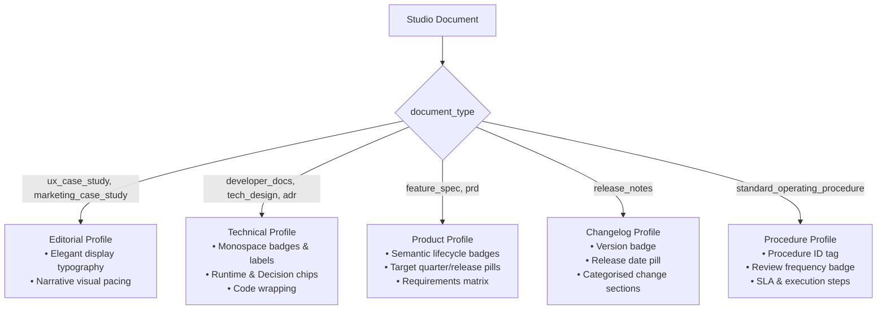

# Multi-Vertical Expansion — Phase 6: Template-Aware Review, Presentation Profiles & Output

**Contract**: `docs/multi-vertical-master-plan.json` (`phase_6_output_review_and_export`).  
**Status**: Completed and fully verified.  
**Branch**: `feature/template`.  
**Content Schema Version**: 3 (stable).  
**Execution Gate**: "Output profiles must not weaken document privacy or expose private assets."

---

## 1. Executive Summary

Phase 6 implements the unified output and review architecture across all nine document disciplines in Write Studio. Rather than rendering all documents identically or maintaining separate export codebases per vertical, the studio uses a shared canonical rendering pipeline with document-type-driven **presentation profiles**:

1. **Editorial Profile** (`editorial`): Used by UX case studies and marketing case studies; features elegant display typography, narrative pacing, and prominent visual storytelling.
2. **Technical Profile** (`technical`): Used by developer guides, technical designs, and ADRs; features monospace labels, status and decision chips, crisp border delineation, line-numbered code fences, and compact parameter specifications.
3. **Product Profile** (`product`): Used by feature specifications and PRDs; features semantic lifecycle status badges (Draft, In Review, Approved, Shipped), target release/quarter indicators, and structured requirement matrices.
4. **Changelog Profile** (`changelog`): Used by release notes; features prominent version badges, release dates, release channel pills, and category-separated change entries.
5. **Procedure Profile** (`procedure`): Used by SOPs and process playbooks; features procedure ID tags, effective date and review frequency chips, step numbers, and RACI owners.

All four output profiles (`pdf`, `html_zip`, `markdown`, `json_backup`) are active and available in `EXPORTS_READY`, and full attribute cleaning enforcement is enabled across all 37 catalogue blocks and their child parts.

---

## 2. Deliverables Summary

| Deliverable | Location | Description |
|---|---|---|
| **Export Profile Availability** | `packages/shared/src/templates/types.ts` | `EXPORTS_READY` updated to include all four profiles: `['pdf', 'html_zip', 'markdown', 'json_backup']`. |
| **Full Cleaning Enforcement** | `packages/shared/src/blocks/contract.ts` | Switched `enforced: true` across all 37 catalogue blocks, all child parts (`tableRow`, `listItem`, etc.), and root nodes (`doc`, `text`, `hardBreak`). |
| **Markdown Export Engine** | `packages/shared/src/blocks/contract.ts` | Added `exportStudyMarkdown()`, generating GitHub-flavoured Markdown with document title, subtitle, summary blockquote, dynamic metadata table, and complete body. |
| **Template-Aware Preview Renderer** | `frontend/src/components/studio/StudioPreview.tsx` | Added `data-presentation={presentation}` on `.preview-page`, dynamic metadata facts based on `template.metadataFields`, and presentation-specific header badges. |
| **Export Menu & Downloader** | `frontend/src/components/studio/ExportMenu.tsx` | Expanded dropdown with PDF, self-contained HTML, Markdown (`.md`), and JSON backup (`-backup.json`). Supports URL parameter auto-run (`?export=pdf\|html\|markdown\|json`). |
| **Editor Integration** | `frontend/src/components/editor/Editor.tsx` | Passes `study` into `ExportMenu` with autosave pre-flight before opening preview or executing exports. |
| **Presentation & Print Styling** | `frontend/src/theme/surfaces.css` | Added styling for presentation badges, presentation-profile variations, and print rules (`break-inside: avoid` for code, terminals, tables, and structured blocks; code wrapping; table auto-layout). |
| **Test Suites** | `packages/shared/test/` & `frontend/test/` | Comprehensive test suites passing with 100% success (blocks, documents, review, schema, security suite). |

---

## 3. Architecture & Specifications

### A. Presentation Profiles Matrix



### B. Export Profiles

1. **PDF Export Profile (`pdf`)**:
   - Triggers native print pipeline via `window.print()` with `@media print` rules.
   - Prevents page breaks inside code blocks, terminals, parameter tables, requirements, user stories, acceptance criteria, procedures, and facts (`break-inside: avoid`).
   - Wraps preformatted code (`white-space: pre-wrap; word-break: break-word`) to eliminate horizontal clipping.
   - Sets background graphics to white paper (`background: var(--bg-gray-inverse) !important`).

2. **Web Page (HTML) Export Profile (`html_zip`)**:
   - Compiles a single self-contained, offline-compatible HTML file.
   - Embeds all same-origin stylesheets, web fonts, and images (as Data URLs) using the owner's active session.
   - Includes standalone vanilla JS for interactive widgets (e.g. comparison slider).
   - Operates completely offline with zero dependency on external origins or expiring signed URLs.

3. **Markdown Export Profile (`markdown`)**:
   - Implemented via `exportStudyMarkdown()`.
   - Produces standard GitHub-flavoured Markdown.
   - Includes `# Title`, `_Subtitle_`, structured metadata attribute table (`| Attribute | Details |`), `> **Summary**`, and complete document body.
   - Converts visual blocks and callouts to accessible text representations (e.g. `> [!NOTE]`, `> [!WARNING]`, fenced code blocks, task lists).

4. **JSON Backup & Asset Manifest Profile (`json_backup`)**:
   - Implemented via `exportJson()`.
   - Produces a complete backup JSON containing:
     ```json
     {
       "schema_version": 3,
       "exported_at": "2026-11-12T16:30:00.000Z",
       "document": { ...studio_document },
       "asset_manifest": [ "/studio/files/...", ... ]
     }
     ```
   - Asset manifest is extracted using `documentMediaPaths()`, cataloging all referenced media files.

---

## 4. Full Cleaning Enforcement

In Phase 3, cleaning was set to report-only for existing blocks until fixtures and test evidence confirmed zero mutation risk. In Phase 6, full cleaning enforcement is active across all node types:

- **Catalogue Blocks (37/37)**: `paragraph`, `heading`, `blockquote`, `bulletList`, `orderedList`, `taskList`, `details`, `codeBlock`, `horizontalRule`, `spacer`, `table`, `callout`, `pullQuote`, `image`, `videoFile`, `fileAttachment`, `embed`, `imageGrid`, `comparison`, `showcase`, `deviceMockup`, `splitLayout`, `annotatedImage`, `screenSequence`, `metrics`, `chart`, `researchInsights`, `timeline`, `flowDiagram`, `terminal`, `parameterTable`, `requirementList`, `userStory`, `acceptanceCriteria`, `testimonial`, `procedureSteps`, `referenceList`.
- **Child Parts**: `terminalCommand`, `terminalOutput`, `parameter`, `requirement`, `storyPart`, `scenario`, `scenarioStep`, `procedureStep`, `reference`, `listItem`, `taskItem`, `detailsSummary`, `detailsContent`, `tableRow`, `tableCell`, `tableHeader`.
- **Root & Inline**: `doc`, `text`, `hardBreak`.

All types return `isEnforcedType(type) === true`.

---

## 5. Privacy, Authorization & Security Invariants

1. **Owner-Only Exports**: All exports run in the authenticated owner's browser session. No public publishing, sharing tokens, or public routes are introduced.
2. **Zero Code Execution**: Code blocks and terminal blocks remain display-only with syntax highlighting; no shell execution or sandboxing is present.
3. **Design System Token Fidelity**: All presentation badges and CSS rules use DNA design tokens exclusively (`var(--surface-container-high)`, `var(--bg-warning-subtle)`, `var(--text-warning-intense)`, `var(--border-info-subtle)`, etc.). No hardcoded HEX colors were introduced.
4. **SEC-015 Compliance**: Verified that no single-owner or portfolio code paths were introduced.

---

## 6. Test Evidence

```
== TypeScript (shared, Express, frontend)
OK

== ESLint (frontend)
OK

== Story review engine (offline)
15/15 passed

== Documents, templates, block catalogue (offline)
29/29 passed

== Block contract: cleaning, text, Markdown, fixtures (offline)
17/17 passed

== Editor and server agree on the document schema (offline)
9/9 passed

== Express build
OK (dist generated)

== Django checks & auth tests
Ran 26 tests in 7.304s (OK)

== Security suite (SEC-015)
Passed (0 violations)
```

---

## 7. Next Steps

- Proceed to **Phase 7: Quality, Beta and Iteration** (cross-vertical verification, template discovery UX, guidance polish, and performance review).
